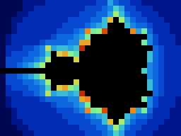

# CharanGPU TFX-X — Milestone 3: SIMT compute cluster

An experimental GPU compute architecture, built end to end. It has an ISA
specification, an assembler, a functional model, a cycle-level C++ model, and
synthesizable SystemVerilog RTL for a multi-warp SIMT cluster. The RTL is
verified against the C++ models cycle for cycle.

> Research/learning prototype. This is not a complete GPU, there is no graphics API or
> driver, and nothing here is fabrication-ready. All performance numbers are
> **simulated cycles** of this design.

## New in milestone 3 (correctness first)

* **Fixed SIMT divergence bug (ISA v1.1).** Branches that left or entered
  `if`/`else` bodies corrupted the mask stack. They are now rejected by the
  assembler and fault at runtime with `BRANCH_DEPTH` (8).
* **Genuinely pipelined multiplier** (`rtl/core/tfx_mul_pipe.sv`). Latency is
  unchanged, so all 208 benchmark cycle counts are identical to milestone 2.
* **31 regression tests written before the fixes** (6 failed before, all pass
  after). They cover forwarding, scoreboard RAW/WAW, load-use, latency hiding,
  barriers, atomics, multiplier edge cases and RTL relaunch.
* **Configurable L1 data-cache model in the C++ cycle simulator only** (no RTL).
  It has capacity, associativity, line size, LRU/FIFO/random replacement, hit/miss
  latency and 8 counters. It is disabled by default, which keeps the simulator
  cycle-exact with the RTL.
* Full report: [docs/milestone3-report.md](docs/milestone3-report.md).

## What's in milestone 2

* **ISA:** TFX-ISA v1.0 ([docs/isa.md](docs/isa.md)), with a machine-readable spec in
  `architecture/isa/tfx_isa_v1.json`.
  * 43 instructions (v1.1 adds a branch depth check, not new opcodes).
  * Integer ALU including MULH/MULHU and immediate forms.
  * Loads, stores and `atom.add` on the scratchpad.
  * Special registers (lane/warp/thread ids, kernel arguments).
  * Structured SIMT divergence (`if/else/endif` mask stack) and warp-uniform branches.
  * Barriers, `exit`, and 8 architectural fault types (`BRANCH_DEPTH` added in v1.1).
* **RTL:** a SIMT cluster with NW warps × NL lanes, all parameters.
  * Single issue, with a per-warp scoreboard and same-cycle writeback bypass.
  * A multiplier pipeline.
  * A banked scratchpad LSU with load broadcast and serialized atomics.
  * Four runtime-selectable warp schedulers: LRR, GTO, PRIO, MEMFIRST.
  * 16 hardware performance counters.
  * A command processor with a ready/valid host interface.
* **Software:**
  * Assembler/disassembler (`compiler/tfxasm.py`).
  * `tfx_sim`, which runs the functional and cycle models in one binary.
  * A co-simulation harness, a fault-injection suite, a constrained-random fuzzer,
    and a mutation test of the verification flow.
  * A benchmark sweep and a logic-synthesis flow.
* **Kernels** (`examples/`): vector add, dependency chain vs ILP, divergence,
  barrier tree reduction, atomic histogram, integer matmul, a bank-conflict stride
  sweep, fixed-point Mandelbrot, a compute-shader triangle rasterizer (edge functions,
  depth test, procedural checker texture) and a 3×3 blur.

The three image kernels render to `results/images/`. Each image is produced by the
cluster itself and is identical on the RTL and the C++ model:

  

## Requirements

* g++ ≥ 9 (C++17)
* Python ≥ 3.9 and pytest
* Icarus Verilog ≥ 12

Optional:
* Verilator, for lint.
* Yosys and [sv2v](https://github.com/zachjs/sv2v), for synthesis.
* CMake.

```bash
sudo apt install -y build-essential python3-pytest iverilog verilator yosys cmake
```

## Quick start

```bash
make test              # fast regression (≈1 min): C++, unit/differential TBs, lint, pytest incl. RTL co-sim
make test-full         # + long RTL kernels, fuzzing on 3 configs, mutation test (≈10 min)
make bench             # simulated benchmark tables -> results/benchmarks/
make images            # render the image kernels (C++ and RTL) -> results/images/
make synth             # generic logic synthesis -> results/synthesis/

# assemble and run one kernel on all three models (C++ functional, C++ cycle, RTL)
python3 tools/cosim/cosim.py --config architecture/configuration/tfx_base.json \
    --program examples/dependency/dep_chain.tfx --arg 0=0 --arg 1=24
```

## Repository map

| Path | Contents |
|---|---|
| `architecture/` | ISA JSON, cluster configurations, config schema |
| `rtl/` | SystemVerilog: `core/` ALU, decoder (and milestone-1 RF/lane), `scheduler/`, `memory/` LSU + scratchpad, `compute/` cluster, `command_processor/`, `interconnect/` FIFO + token channel, `top/` |
| `sim/` | self-checking testbenches, including the system TB `tb_charangpu_top.sv` |
| `software/reference/` | ISA semantics, decoder and scheduler reference (C++), vector generators |
| `simulator/` | `tfx_sim`: config loader, functional model, cycle-level timing model |
| `compiler/` | `tfxasm.py` assembler/disassembler |
| `examples/` | `.tfx` kernels and fault programs |
| `benchmarks/` | workloads with Python golden models, benchmark sweep |
| `tools/` | co-simulation, faults, fuzzer, mutation test, image renderer, config validator |
| `synthesis/yosys/` | sv2v + Yosys logic-synthesis script |
| `tests/` | pytest suite and the RTL unit-TB runner |
| `docs/` | architecture, ISA, execution model, scheduler, memory, host interface, verification, benchmarks, limitations, ASIC roadmap, ADRs |
| `results/` | generated benchmark tables, synthesis reports, images |

## Results recorded for milestone 2

(Milestone 3 results are in [docs/milestone3-report.md](docs/milestone3-report.md).)

All results below come from commands that were actually run. Details are in
[docs/verification.md](docs/verification.md),
`results/benchmarks/benchmarks.md` and `results/synthesis/summary.txt`.

* **Verification:** the RTL agrees exactly with the C++ cycle model on cycle count,
  all counters, every register, every scratchpad word, fault state, and the full
  per-cycle issue trace.
  * This holds for all 13 kernels on `tfx_base` and `tfx_small`, 11 on `tfx_onebank`
    and 5 on `tfx_wide`, under all 4 scheduler policies.
  * It holds for 185 random programs across 4 configurations.
  * All fault programs pass on 2 configurations (12 programs for 7 codes in milestone 2; 13 for 8 codes since milestone 3).
  * 4 of 4 deliberately injected RTL bugs were caught.
* **Benchmarks (simulated, tfx_base):**
  * IPC ranges from 0.53 (bank-conflicted stride) to 0.999 (blur).
  * Each extra MUL-latency cycle costs a 1-warp dependent chain about 24 cycles, while
    4 warps hide latency up to 4 completely.
  * MEMFIRST was the best scheduling policy on 7 of 13 kernels and never more than
    2.5 % slower than the best.
* **Synthesis:** logic synthesis only (generic cells, no PDK, no timing). The ALU was
  about 14.5 k cells (dominated by the multiplier); a 2-warp × 4-lane cluster was
  about 130 k cells. Milestone 3 figures (ALU 1,553 cells with `HAS_MUL=0`,
  cluster 122,484 cells) are in the milestone-3 report.

## Limitations

See [docs/known-limitations.md](docs/known-limitations.md). In short:
* Integer only, with one cluster.
* No caches or DRAM.
* The L1 data cache exists only in the C++ simulator.
* The cluster's critical path is not yet identified.
* No FPGA or silicon results.

Milestone-1 content (the ALU v0.1 ops, register file, compute lane, FIFO and token
channel) is retained, backward compatible, and still tested.
